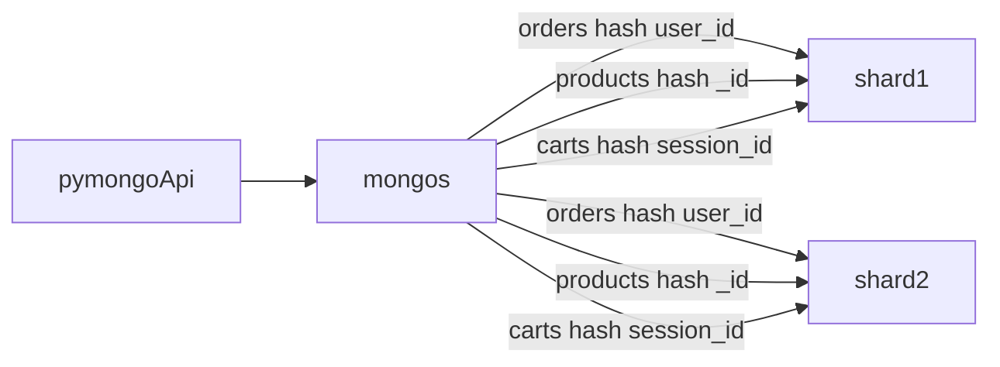

# Архитектурный документ. Задания 7–10

Один документ на задания 7–10. 
Команды относятся к базе магазина `shop`.

## Состав

Формулировки — из списка сдачи заданий 7–10 и из блоков «Решение» заданий 7–10.

| Пункт                                                                                                                      | Статус                                                                       |
| -------------------------------------------------------------------------------------------------------------------------- | ---------------------------------------------------------------------------- |
| Описание и обоснование решений                                                                                             | закрыто заданиями 7 и 8                                                      |
| Структуры: схемы коллекций MongoDB и таблицы Cassandra, ключевые поля и типы                                               | схемы MongoDB — закрыто заданием 7; таблицы Cassandra — пусто                |
| Шард-ключи и partition key: зачем так и какие риски                                                                        | шард-ключи — закрыто заданием 7; partition key — пусто                       |
| Короткие примеры: `sh.shardCollection`, конфигурация реплик, CQL                                                           | `sh.shardCollection` — закрыто заданием 7; конфигурация реплик и CQL — пусто |
| Диаграммы или таблицы: кластер, потоки, сравнение вариантов                                                                | закрыто заданием 7                                                           |
| Метрики мониторинга и что делать, если просела производительность или консистентность                                      | производительность — закрыто заданием 8; консистентность — пусто             |
| Таблица чтений: primary или secondary, допустимая задержка, обоснование                                                    | пусто                                                                        |
| Стратегии Cassandra: Hinted Handoff, Read Repair, Anti-Entropy Repair                                                      | пусто                                                                        |
| Задание 7: схема `orders`, схема `products`, схема `carts`, команды MongoDB                                                | закрыто заданием 7                                                           |
| Задание 8: метрики состояния шардов, признак горячего шарда, перераспределение, команды и настройки, популярные категории  | закрыто заданием 8                                                           |
| Задание 9: таблица primary / secondary по операциям трёх коллекций, допустимая задержка и обоснование                      | пусто                                                                        |
| Задание 10: что переносим и почему, partition key и clustering keys, CQL, Hinted Handoff, Read Repair, Anti-Entropy Repair | пусто                                                                        |

Картинки задания 7, рядом с решениями: [ADR-005](adr/0005-orders-shard-key.md) `orders`, [ADR-006](adr/0006-products-shard-key.md) `products`, [ADR-007](adr/0007-carts-shard-key.md) `carts`, [контейнеры](c4/07-collections.puml), [создание заказа и списание остатка](c4/07-order-stock.puml), [слияние корзины](c4/07-cart-merge.puml). Кластер тот же, что в [ADR-002](adr/0002-two-shards.md): приложение шард не выбирает, маршрутизирует `mongos`.

## Задание 7. Схемы коллекций

В MongoDB три коллекции магазина: `orders`, `products`, `carts`. Для каждой ниже схема документа с типами, кандидаты в шард-ключ, выбранные стратегия и ключ, связь ключа с операциями, риск и точечный запрос.

Стратегия всех трёх — **хэшированное** шардирование. У нас равномерная раскладка важнее поиска по диапазону: сессии и товары магазина. Хэш значения определяет шард. Одно и то же значение всегда даёт один хэш. Документ едет на шард целиком.

### Кластер

`pymongo-api` ходит в `mongos`. Роутер читает карту чанков и отправляет запрос на `shard1` или `shard2`. Приложение шард не выбирает. На связях три коллекции и их ключи. Поток заказа и остатка — [07-order-stock.puml](c4/07-order-stock.puml). Слияние корзины — [07-cart-merge.puml](c4/07-cart-merge.puml).



Диапазонное, динамическое и геошардинг разобраны как отклонённые альтернативы.

| Стратегия | Почему отклонена |
| --- | --- |
| Диапазонное | Близкие ключи садятся в один чанк, раскладка легко перекашивается. Монотонное время кладёт новые записи в последний чанк. |
| Динамическое | Сегмент ищет отдельный сервис, и этот сервис — единая точка отказа. Кластер уже маршрутизирует через `mongos`. |
| Геошардинг | Зон мало, крупный регион перевешивает. Операции читают клиента, товар и корзину. |

### orders

Заказы клиентов. История одного клиента и создание его заказа попадают в один шард. Разные клиенты дают разный хэш, записи чёрной пятницы не садятся в один «сейчас».

**Ключ:** хэш `user_id`. Команда — в [блоке команд](#команды-mongodb).

| Поле | Тип | Роль |
| --- | --- | --- |
| `_id` | ObjectId | id заказа |
| `user_id` | string | id клиента, шард-ключ |
| `created_at` | date | дата и время оформления |
| `items` | array | позиции заказа |
| `items.product_id` | string | товар |
| `items.price` | decimal | цена на момент покупки |
| `items.category` | string | категория на момент покупки |
| `items.qty` | int | количество |
| `status` | string | состояние заказа |
| `total` | decimal | общая сумма |
| `zone` | string | геозона заказа |

Позиции — массив внутри заказа: товар, цена на момент покупки, категория. Остаток живёт в `products`. Списание остатка идёт по `_id` товара и может попасть на другой шард: у заказа и у товара разные ключи. Маршрут — [07-order-stock.puml](c4/07-order-stock.puml).

```javascript
{
  _id: ObjectId("64b000000000000000000001"),
  user_id: "u-42",
  created_at: ISODate("2026-11-27T10:15:00Z"),
  items: [
    { product_id: "p-phone", price: NumberDecimal("39990"), category: "Электроника", qty: 1 },
    { product_id: "p-book", price: NumberDecimal("890"), category: "Книги", qty: 1 }
  ],
  status: "оформлен",
  total: NumberDecimal("40880"),
  zone: "Москва"
}
```

| Кандидат | Стратегия | Итог |
| --- | --- | --- |
| `user_id` | хэш | выбран |
| `created_at` | диапазон | отклонён: монотонный ключ, все новые заказы в последнем чанке |
| `zone` | гео | отклонён: мало значений, Москва перевешивает, история читается по клиенту |
| `_id` | хэш | отклонён: запись ровная, история клиента обходит все шарды, а эта операция в задании есть |
| `status` | хэш | отклонён: слишком мало значений |

Операции и ключ:

- Создание заказа — вставка с `user_id`. Хэш ведёт документ в один шард.
- История заказов клиента — равенство по `user_id`. Тот же шард, вторичный индекс `{ user_id: 1, created_at: -1 }` сортирует на нём.
- Статус заказа показывается вместе с id клиента. Фильтр `{ _id, user_id }` остаётся точечным.

Риск: статус только по id заказа, без `user_id`, уходит на оба шарда. Показ статуса идёт вместе с id клиента.

```javascript
db.orders.find({ user_id: "u-42" }).sort({ created_at: -1 })
```

Поле `user_id` ведёт запрос в один шард.

### products

Товары. Частые списания остатка и карточка товара — точечные операции по id, один шард. Хэш к товарам, равномерность важнее поиска по диапазону.

**Ключ:** хэш `_id`.

| Поле         | Тип      | Роль                              |
| ------------ | -------- | --------------------------------- |
| `_id`        | string   | id товара, шард-ключ              |
| `name`       | string   | наименование                      |
| `category`   | string   | категория, например «Электроника» |
| `price`      | decimal  | текущая цена                      |
| `stock`      | array    | остаток в каждой геозоне          |
| `stock.zone` | string   | геозона                           |
| `stock.qty`  | int      | количество                        |
| `attrs`      | object   | цвет, размер и другое             |

Остаток по геозонам — массив `{ zone, qty }` внутри товара. Списание — одно обновление документа. Идентификатор товара — строка: `products._id`, `orders.items.product_id` и `carts.items.product_id` хранят одно значение. `_id` заказа и `_id` корзины остаются ObjectId.

```javascript
{
  _id: "p-phone",
  name: "Смартфон X",
  category: "Электроника",
  price: NumberDecimal("39990"),
  stock: [
    { zone: "Екатеринбург", qty: 50 },
    { zone: "Калининград", qty: 30 }
  ],
  attrs: { color: "чёрный" }
}
```

| Кандидат | Стратегия | Итог |
| --- | --- | --- |
| `_id` | хэш | выбран |
| `category` | хэш | отклонён: мало значений, «Электроника» собрала бы большую часть операций на одном шарде |
| `price` | диапазон | отклонён: фильтр по цене стал бы легче, смена цены двигает документ, списание остатка идёт по id |
| `zone` | гео | отклонён: остаток — массив `stock` внутри товара |

Операции и ключ:

- Списание остатка и карточка товара фильтруют по `_id`. Один шард, одно обновление документа.
- Поиск по категории и диапазону цены идёт по вторичному индексу `{ category: 1, price: 1 }`. В фильтре нет шард-ключа, запрос обходит оба шарда.

Риск: каталог — scatter-gather по этому индексу. Популярный товар может греть свой шард. Ключ при этом остаётся `_id`: категория собрала бы операции на одном шарде. Метрики перекоса — задание 8.

```javascript
db.products.updateOne(
  { _id: "p-phone", "stock.zone": "Екатеринбург" },
  { $inc: { "stock.$.qty": -1 } }
)
```

Поле `_id` ведёт обновление в один шард.

### carts

Текущие корзины: гостевые и пользовательские. В задании два фильтра текущей корзины: `{ session_id, status: "active" }` и `{ user_id, status: "active" }`. Один `sh.shardCollection` задаёт один ключ на коллекцию. Запрос попадает в один шард, когда в фильтре есть этот ключ. Приложение шард не выбирает, маршрутизирует `mongos`.

**Ключ:** хэш `session_id`. Поле обязательное и у гостя, и у вошедшего: после логина сессию не стираем. Корзины чёрной пятницы раскладываются по разным сессиям. Урок называет хэш подходящим для сессий.

| Поле               | Тип             | Роль                                           |
| ------------------ | --------------- | ---------------------------------------------- |
| `_id`              | ObjectId        | id корзины                                     |
| `user_id`          | string или null | пользователь, если залогинен                   |
| `session_id`       | string          | шард-ключ, обязателен и у гостя, и у вошедшего |
| `items`            | array           | строки корзины                                 |
| `items.product_id` | string          | товар                                          |
| `items.quantity`   | int             | количество                                     |
| `status`           | string          | `"active"`, `"ordered"`, `"abandoned"`         |
| `created_at`       | date            | создание                                       |
| `updated_at`       | date            | последнее обновление                           |
| `expires_at`       | date            | срок TTL                                       |

```javascript
{
  _id: ObjectId("64b000000000000000000020"),
  user_id: null,
  session_id: "s-7f3a",
  items: [{ product_id: "p-phone", quantity: 1 }],
  status: "active",
  created_at: ISODate("2026-11-27T10:00:00Z"),
  updated_at: ISODate("2026-11-27T10:05:00Z"),
  expires_at: ISODate("2026-12-04T10:00:00Z")
}
```

У вошедшего в той же сессии `session_id` остаётся, рядом записан `user_id`.

| Кандидат | Стратегия | Итог |
| --- | --- | --- |
| `session_id` | хэш | выбран |
| `user_id` | хэш | отклонён: у гостя поля нет, такие документы садятся в один чанк |
| `owner_id` | хэш | отклонён: поля нет в атрибутах задания, фильтры его не содержат, запрос без шард-ключа идёт на оба шарда |
| `status` | хэш | отклонён: мало значений, в двух фильтрах задания общее только оно |
| `created_at` | диапазон | отклонён: монотонный край |
| `_id` | хэш | отклонён: запись ровная, чтение текущей корзины обходит все шарды |

Гость, добавление, удаление и смена статуса в этой сессии идут по `{ session_id, status: "active" }` и попадают в один шард. Индекс `{ session_id: 1, status: 1 }` обслуживает этот фильтр на шарде.

Вошедший в той же сессии оставляет в фильтре `user_id` и обязательный `session_id`. Ключ на месте, запрос на один шард.

```javascript
db.carts.findOne({ session_id: "s-7f3a", status: "active" })
db.carts.findOne({ session_id: "s-7f3a", user_id: "u-42", status: "active" })
```

Поле `session_id` ведёт оба запроса в один шард.

Риск: корзина только по `{ user_id, status: "active" }`, когда сессия этой корзины неизвестна, уходит на оба шарда. Это шаг слияния при логине, если у пользователя уже есть корзина с другой сессии.

Слияние: чтение гостевой по `session_id` — один шард; дописывание в пользовательскую только по `user_id` — оба шарда; гостевую помечаем `abandoned` снова по `session_id`. Маршрут — [07-cart-merge.puml](c4/07-cart-merge.puml).

```javascript
const guest = db.carts.findOne({ session_id: sessionId, status: "active" })
db.carts.updateOne(
  { user_id: userId, status: "active" },
  { $push: { items: { $each: guest.items } }, $currentDate: { updated_at: true } }
)
db.carts.updateOne(
  { session_id: sessionId, status: "active" },
  { $set: { status: "abandoned" }, $currentDate: { updated_at: true } }
)
```

`expires_at` — TTL-индекс `{ expires_at: 1 }` с `expireAfterSeconds: 0`. На шардированной коллекции просрочку снимает каждый шард у своих чанков.

### Команды MongoDB

```javascript
sh.enableSharding("shop")
sh.shardCollection("shop.orders", { user_id: "hashed" })
sh.shardCollection("shop.products", { _id: "hashed" })
sh.shardCollection("shop.carts", { session_id: "hashed" })

db.orders.createIndex({ user_id: 1, created_at: -1 })
db.products.createIndex({ category: 1, price: 1 })
db.carts.createIndex({ session_id: 1, status: 1 })
db.carts.createIndex({ expires_at: 1 }, { expireAfterSeconds: 0 })
```

| Индекс | Операция |
| --- | --- |
| `orders { user_id: 1, created_at: -1 }` | история заказов клиента, новые сверху |
| `products { category: 1, price: 1 }` | каталог: категория и диапазон цены, обход обоих шардов |
| `carts { session_id: 1, status: 1 }` | текущая корзина сессии, добавление, удаление, смена статуса |
| `carts { expires_at: 1 }`, `expireAfterSeconds: 0` | снятие просроченных корзин на каждом шарде |

## Задание 8. Горячие шарды

Категория «Электроника» перегрузила один шард: 70% запросов шло на эти товары. Та же доля у любой следующей категории — тот же признак. Ключ `products` остаётся хэш `_id`, [ADR-006](adr/0006-products-shard-key.md). Кто снимает метрики и при каком пороге шард горячий — [ADR-008](adr/0008-hot-shards.md).

Отдельного экрана метрик на стенде нет. Смотрим вывод `mongosh` в каталоге `sharding-repl-cache`.

### Кто снимает и где смотреть

Объём коллекции собирает балансировщик. Процесс сидит на primary `configSrv`. Смотрим его с сервиса `mongos_router`.

Операции, задержку и категорию снимаем на primary шарда. На стенде primary сначала `shard1-1` и `shard2-1`. Перед снятием читаем `db.hello().primary`. Если primary другой узел набора, команды идут на него. `opcounters` считает узел, который выполнил операцию.

| Что                     | Кто собирает                         | Где смотрим                                   | Поля                                                                                                                                                                                                              |
| ----------------------- | ------------------------------------ | --------------------------------------------- | ----------------------------------------------------------------------------------------------------------------------------------------------------------------------------------------------------------------- |
| Объём, чанки, документы | балансировщик на primary `configSrv` | `mongos_router`                               | `balancerCompliant`; в `getShardDistribution` — `data`, `docs`, `chunks`                                                                                                                                          |
| Число байт для порога   | тот же снимок коллекции              | `mongos_router`, `stats().shards`             | `size` в байтах по `shard1` и `shard2`                                                                                                                                                                            |
| Включён ли перенос      | балансировщик                        | `mongos_router`                               | `sh.getBalancerState()`, `sh.isBalancerRunning()`                                                                                                                                                                 |
| Операции и задержка     | команда на primary                   | `shard1-1` и `shard2-1`, либо текущий primary | `opcounters.query`, `opcounters.update`, `opcounters.getmore`, `opcounters.insert`; `opLatencies.reads` и `opLatencies.writes` (`latency` в микросекундах, `ops`); `connections.current`, `connections.available` |
| Категория запроса       | профилировщик на том же primary      | `system.profile`                              | `ns: "shop.products"`, `command.filter.category`                                                                                                                                                                  |

`opcounters` на primary — по всему узлу, не только по `products`. Доля категории отделяет «Электронику» от остальных запросов этого шарда. `connections` и `insert` остаются в снимке состояния. Признак горячего шарда считают доля операций и разница `size`.

Коллекции объёма: `shop.products`, `shop.orders`, `shop.carts`. Инцидент сидит в `products`. Порог байт один и тот же для трёх коллекций.

### По каким параметрам

Окно операций — 60 секунд. Два раза `serverStatus`, в расчёт идёт разница.

Доля операций шарда = `(Δquery + Δupdate + Δgetmore)` этого шарда / сумма по двум шардам.

Разница данных = `size` шарда, где байт больше, минус `size` шарда, где байт меньше. Балансировщик начинает перенос, когда разница достигает 3 × размер чанка. Без документа `chunksize` в `config.settings` размер чанка 128 МБ, порог **384 МБ** (`384 * 1024 * 1024` байт).

| Параметр | Порог | Что делаем |
| --- | --- | --- |
| Доля операций шарда | ≥ 0,70 | горячий по трафику. 0,70 — из задания. Значение `category` в формуле нет |
| Средняя задержка чтения | сравнение двух шардов | `(ΔopLatencies.reads.latency) / (ΔopLatencies.reads.ops)` за те же 60 секунд, микросекунды. Порога в миллисекундах задание не даёт. Смотрим, выше ли она у шарда с долей ≥ 0,70 |
| Разница `size` и `balancerCompliant: false` | разница ≥ 384 МБ | скос данных. Балансировщик или ручной `moveChunk` |
| Доля операций ≥ 0,70 и разница `size` < 384 МБ | жар запросов при ровных данных | `moveChunk` перевозит жар на другой шард |
| Доля одного значения `category` | ≥ 0,70 | категория горячая. Сегодня это может быть «Электроника». Порог тот же для любого значения поля |

Долю категории снимаем окном в 60 секунд: `setProfilingLevel(2)` на обоих primary, затем `setProfilingLevel(0)`. Доля = число записей `shop.products` с одним `filter.category` / все записи `shop.products` за окно. Уровень 2 только на это окно: журнал профилировщика сам грузит шард.

### Перераспределение

Балансировщик на primary `configSrv` включён сам. Он шлёт перенос, когда разница `size` коллекции ≥ 384 МБ. Окно миграций 01:00–05:00 — пример настройки, чтобы перенос шёл вне распродажи. Порог доли 0,70 — из задания. Порог 384 МБ — 3 × чанк по умолчанию.

Ручной `sh.moveChunk("shop.products", { _id: "p-phone" }, "shard2")` — когда разница уже ≥ 384 МБ, а `balancerCompliant` остаётся `false`. Поле `_id` — шард-ключ, по нему находится чанк. Один `_id` целиком лежит в одном чанке.

### Команды и настройки MongoDB

С `mongos_router`. Объём трёх коллекций, байты для порога и состояние балансировщика.

```javascript
sh.balancerCollectionStatus("shop.products")
sh.balancerCollectionStatus("shop.orders")
sh.balancerCollectionStatus("shop.carts")

db.getSiblingDB("shop").products.getShardDistribution()
db.getSiblingDB("shop").orders.getShardDistribution()
db.getSiblingDB("shop").carts.getShardDistribution()

const sizes = Object.values(db.getSiblingDB("shop").products.stats().shards).map(s => s.size)
const diff = Math.max(...sizes) - Math.min(...sizes)

sh.getBalancerState()
sh.isBalancerRunning()
```

`diff` сравниваем с `384 * 1024 * 1024`. `balancerCompliant: false` при такой разнице — скос данных.

На primary каждого шарда. Сначала узел, затем два снимка с паузой 60 секунд.

```javascript
db.hello().primary
// дальше — на этом узле

const before = db.serverStatus()
// 60 секунд
const after = db.serverStatus()
const ops = {
  query: after.opcounters.query - before.opcounters.query,
  update: after.opcounters.update - before.opcounters.update,
  getmore: after.opcounters.getmore - before.opcounters.getmore
}
const readLatencyUs =
  (after.opLatencies.reads.latency - before.opLatencies.reads.latency) /
  (after.opLatencies.reads.ops - before.opLatencies.reads.ops)
```

Доля шарда = `(ops.query + ops.update + ops.getmore)` / сумма тех же сумм `shard1` и `shard2`. `readLatencyUs` — микросекунды.

Категория на том же primary. Окно 60 секунд, журнал перед окном пустой.

```javascript
db.setProfilingLevel(0)
db.system.profile.drop()
db.setProfilingLevel(2)
// 60 секунд
db.setProfilingLevel(0)

const total = db.system.profile.countDocuments({ ns: "shop.products" })
db.system.profile.aggregate([
  { $match: { ns: "shop.products", "command.filter.category": { $exists: true } } },
  { $group: { _id: "$command.filter.category", n: { $sum: 1 } } },
  { $sort: { n: -1 } }
])
```

Доля значения = `n / total`. Порог 0,70.

Окно переноса и ручной перенос — с `mongos_router`, когда разница `size` уже ≥ 384 МБ.

```javascript
db.getSiblingDB("config").settings.updateOne(
  { _id: "balancer" },
  { $set: { activeWindow: { start: "01:00", stop: "05:00" } } },
  { upsert: true }
)

sh.moveChunk("shop.products", { _id: "p-phone" }, "shard2")
```

До смены ключа, с `mongos_router`, база `shop`.

```javascript
db.products.analyzeShardKey({ category: 1 })
db.products.analyzeShardKey({ _id: "hashed" })
```

| Настройка | Зачем |
| --- | --- |
| `activeWindow` 01:00–05:00 | перенос чанков вне пика распродажи |
| порог 384 МБ | 3 × чанк 128 МБ, после этого балансировщик начинает перенос |
| `sh.moveChunk` | ручной перенос, когда разница `size` ≥ 384 МБ и `balancerCompliant` остаётся `false` |
| `setProfilingLevel(2)` на 60 секунд | доля одного значения `category` |
| `analyzeShardKey` | сравнить `{ category: 1 }` и `{ _id: "hashed" }` до смены ключа |

### Популярные категории

Шард-ключ `products` остаётся хэш `_id`. Категория живёт во вторичном индексе `{ category: 1, price: 1 }` из задания 7. В фильтре каталога шард-ключа нет, запрос идёт на оба шарда. Следующая категория с долей ≥ 0,70 попадает на оба шарда так же. В пороге доля. «Электроника» — пример значения поля.

Повтор каталога этой категории и карточки товара закрываем тем же Cache Aside, что в [ADR-004](adr/0004-redis.md). На стенде так закрыт список `GET /{collection}/users`. Для `shop.products` тот же приём: пока ключ жив, повтор с долей категории ≥ 0,70 не идёт в шард. Горячий товар — один документ, он целиком лежит в одном чанке.

`analyzeShardKey`: у `{ category: 1 }` мало значений, у `{ _id: "hashed" }` этого перекоса нет.

Шард добавляем вне распродажи. В пике балансировщик начинает массовый перенос. Добавление шарда — граница с заданием 10.
